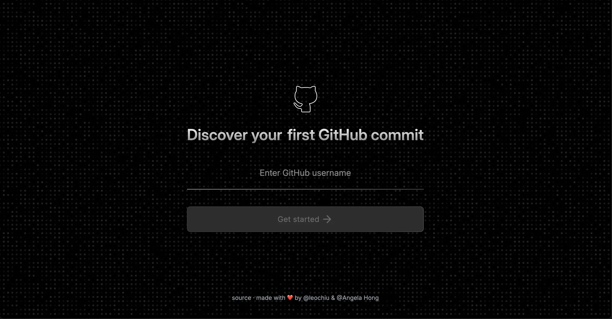

# My First GitHub Commit 🚀



A web application that helps you discover your very first GitHub commit! Enter any GitHub username and travel back in time to see where it all began.

**🔗 Live Demo:** https://my-first-github-commit.vercel.app/

## ✨ Features

- 🔍 **Search by Username**: Simply enter any GitHub username to get started
- 📅 **Time Travel**: Discover the very first commit made by any GitHub user
- 🎨 **Beautiful UI**: Clean, modern interface with smooth interactions
- ⚡ **Fast & Responsive**: Built with performance in mind
- 🌙 **Dark Theme**: Easy on the eyes with a sleek dark design

## 🛠️ Tech Stack

- **[Remix 2](https://remix.run/)** - Full-stack web framework
- **[React 18](https://react.dev/)** - UI library with latest features
- **[Tailwind CSS](https://tailwindcss.com/)** - Utility-first CSS framework
- **[Shadcn/ui](https://ui.shadcn.com/)** - Beautiful, accessible components
- **[GitHub API](https://docs.github.com/en/rest)** - Fetching commit data
- **[TypeScript](https://www.typescriptlang.org/)** - Type safety and better DX

## 🚀 Getting Started

### Prerequisites

- Node.js 18+
- pnpm

### Installation

1. **Clone the repository**

   ```bash
   gh repo clone leochiu-a/my-first-github-commit
   # or
   git clone https://github.com/leochiu-a/my-first-github-commit.git
   ```

2. **Navigate to the project directory**

   ```bash
   cd my-first-github-commit
   ```

3. **Install dependencies**

   ```bash
   pnpm install
   ```

4. **Start the development server**

   ```bash
   pnpm dev
   ```

5. **Open your browser**
   Visit [http://localhost:5173](http://localhost:5173) to see the app in action!

## 🌟 How It Works

1. Enter any GitHub username in the search field
2. Click "Get started" or press Enter
3. The app fetches all repositories for that user
4. Searches through commit history to find the very first commit
5. Displays the historic first commit with details

---

<div align="center">
  <p>Made with ❤️ by <a href="https://github.com/leochiu-a">@leochiu</a> & <a href="https://github.com/Angela-Hong">@Angela Hong</a></p>
  <p>
    <a href="https://my-first-github-commit.vercel.app/">🔗 Try it out!</a>
  </p>
</div>
